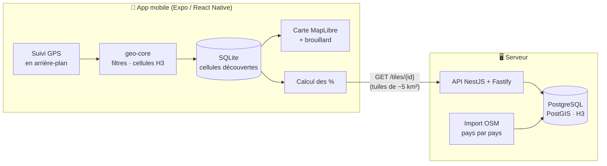

<div align="center">

# 🌫️ Fog

**Le brouillard de guerre, dans la vraie vie.**

Une carte du monde recouverte de brouillard, qui se dissipe partout où tu passes.
Arpente ta ville, découvre chaque ruelle, et regarde ton pourcentage d'exploration grimper,
de ton quartier jusqu'au monde entier.


</div>

---

## ✨ Le concept

Comme dans un jeu de stratégie en temps réel, la carte démarre entièrement dans le brouillard. Chaque déplacement, à pied, à vélo, en voiture ou en train, révèle ce qui t'entoure.

```
  3ᵉ arrondissement ██████████████████████  100 %   « J'ai fait toutes les rues ! »
  Paris             ███░░░░░░░░░░░░░░░░░░░   12 %
  Île-de-France     ░░░░░░░░░░░░░░░░░░░░░░  0,8 %
  France            ░░░░░░░░░░░░░░░░░░░░░░ 0,02 %
  Monde             ░░░░░░░░░░░░░░░░░░░░░░ 0,0003 %   « Le monde est grand. »
```

- **Passif :** pas de session à lancer, l'app enregistre en arrière-plan.
- **Partout :** l'enregistrement fonctionne dans le monde entier, même hors connexion.
- **Multi-échelle :** un score par arrondissement, ville, région, pays et pour le monde.
- **Respectueux de la vie privée :** ta position précise ne quitte jamais ton téléphone.

## 🧭 Comment ça marche

Le monde est découpé en **cellules hexagonales [H3](https://h3geo.org/) d'environ 9 m**, la taille de la précision d'un GPS de téléphone.

1. Le téléphone reçoit ta position et la convertit en cellules : celle où tu te trouves, celles entre deux points pour combler les trous, et un petit rayon autour.
2. Ces cellules **découvertes** dissipent le brouillard sur la carte.
3. À partir d'[OpenStreetMap](https://www.openstreetmap.org/), on sait quelles cellules contiennent une voie : rue, ruelle, sentier, place…
4. **Ton % = cellules de voies découvertes ÷ cellules de voies de la zone.**

Tout ce qui se parcourt physiquement compte, du boulevard au sentier de randonnée. Atteindre 100 % n'est pas toujours possible, à cause des voies privées par exemple, et c'est voulu : le score reflète ce que tu parcours vraiment.

## 🏗️ Architecture



Le téléphone enregistre, découvre et calcule. Le serveur ne fournit que des **données géographiques publiques** (les voies et les zones) et ne sait rien de tes déplacements.

## 🛠️ Stack

| Domaine | Technologies |
|---|---|
| App mobile | Expo, React Native, TypeScript, Expo Router, expo-location, expo-sqlite |
| Carte | MapLibre, fond OpenFreeMap (OpenStreetMap) |
| Géographie | h3-js, H3 (résolution 12) |
| Backend | NestJS (adaptateur Fastify), PostgreSQL, PostGIS, h3-pg |
| Données | OpenStreetMap via Geofabrik, osmium |
| Qualité | TypeScript strict, ESLint, Prettier, Vitest, Jest, GitHub Actions |

## 📁 Organisation du dépôt

```
fog/
├── apps/
│   ├── mobile/          # App Expo (React Native)
│   └── api/             # API NestJS
├── packages/
│   └── geo-core/        # Logique géographique partagée (H3, filtres, %)
├── tools/
│   └── osm-importer/    # Import OpenStreetMap → PostgreSQL
└── docs/                # Spécifications et plans d'implémentation
```

> Cette structure est la cible. Elle se met en place au fil des plans d'implémentation.

## 🗺️ Feuille de route

**v1 : prototype solo**

- [ ] **Plan 1 :** fondations du monorepo et `geo-core`
- [ ] **Plan 2 :** données et API (import OSM de la France, `/tiles`, `/meta`)
- [ ] **Plan 3 :** app mobile (suivi en arrière-plan, découverte, écran Progression)
- [ ] **Plan 4 :** carte et brouillard (rendu à plusieurs niveaux de zoom, écran d'accueil, tests sur le terrain)

**Ensuite**

- Comptes (connexion Google et Apple) et synchronisation
- Classement entre amis
- Guildes et carte coopérative
- Map matching pour un % au mètre de rue près
- Import d'autres pays, puis du monde entier

## 🔒 Vie privée

- Aucune **trace GPS brute** n'est conservée : seulement les cellules découvertes et leur date.
- Ta position précise **ne quitte jamais le téléphone**. L'app ne demande au serveur que des tuiles d'environ 5 km².
- Aucun compte en v1, aucun outil de pistage ni d'analyse d'usage.

## 📚 Documentation

- [Spécification de la v1](docs/superpowers/specs/2026-10-16-fog-v1-design.md)
- [Plan 1 : fondations et geo-core](docs/superpowers/plans/2026-10-16-fog-plan-1-fondations-geo-core.md)

## 🚀 Démarrage

> Les instructions d'installation arriveront avec le plan 1 (monorepo, scripts `pnpm`).

**Prérequis prévus :** Node 22, pnpm 9, Docker, et Xcode et/ou Android Studio.

---

<div align="center">
<sub>Données cartographiques © <a href="https://www.openstreetmap.org/copyright">contributeurs OpenStreetMap</a></sub>
</div>
